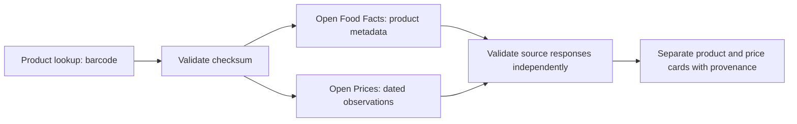
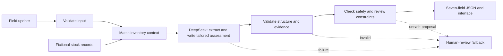

# SalesEasy assessment

A small Next.js sales copilot that accepts a plain-text field update and returns the assessment's seven-field JSON response. DeepSeek receives the report and matched fictional inventory. It extracts observations and writes a tailored assessment. Backend checks reject unsupported evidence and decisions that violate required safety or review constraints. No database is needed.

**Public demo:** [sales-easy-copilot.vercel.app](https://sales-easy-copilot.vercel.app) · **Source:** [raj921/sales-easy-copilot](https://github.com/raj921/sales-easy-copilot)

No login is required. Choose a fictional sample, click **Assess field update**, then use the **Overview**, **Evidence**, and **JSON** tabs. All ten real-provider evaluation cases passed locally and on the public demo, including locked storage and a delivery-access problem. See [EVALUATION.md](EVALUATION.md) for measured outcomes.

## Run locally

Use Node.js 24 (see `.nvmrc`).

```sh
npm ci
cp .env.example .env.local
```

Set `DEEPSEEK_API_KEY` in `.env.local`. Keep it on the server; do not use a `NEXT_PUBLIC_` variable. The supplied defaults are:

```dotenv
DEEPSEEK_MODEL=deepseek-flash
DEEPSEEK_TIMEOUT_MS=15000
DEEPSEEK_MAX_RETRIES=1
```

Then run `npm run dev` and open http://localhost:3000. The interface offers ten fictional scenarios, separate evidence and JSON tabs, and a personal information checklist. Real analysis calls use your DeepSeek account. The last six assessments stay only in tab memory and clear on reload. Only appearance, spacing, and the preferred result tab are saved in browser local storage. The update is sent to DeepSeek when you assess it.

## Workspace controls

- **Field reports:** choose or filter a scenario, write a report, and press **Assess field update** or Ctrl/Cmd + Enter. Cancel stops waiting in the browser; it does not guarantee the provider stopped processing.
- **Results:** read the recommendation, inspect evidence labels, or view the exact seven-field JSON. Copy a readable summary, copy JSON, or download JSON. Checklist ticks are personal notes, not verified evidence.
- **Recent in this tab:** reopen up to six assessments without another model call. A reload clears reports and checklist ticks. The app does not implement an approval inbox or notify reviewers.
- **Reference inventory:** inspect the three fictional records and start a report for an outlet/SKU. No incident is invented for you.
- **Preferences:** choose light/dark/system appearance, comfortable/compact spacing, and an initial result tab. The native dialog supports Escape and restores focus.

## Separate real-data lookup

**Product lookup** is an optional extension outside the fictional-data assessment flow. Enter a valid GTIN-8, UPC-A, EAN-13, or GTIN-14 barcode and explicitly submit. No account or new API key is needed. The example `5449000000996` identifies a **330 ml** product; it is not the fictional **500 ml** stock fixture.

```sh
curl http://localhost:3000/api/products/lookup \
  -H 'Content-Type: application/json' \
  -d '{"barcode":"5449000000996"}'
```

The server checks the barcode checksum, then reads fixed Open Food Facts and Open Prices origins in parallel with an eight-second timeout per source. Public responses may be cached for 15 minutes; `fetched_at` records lookup time, not guaranteed source refresh time. Requests return independently labelled product and price statuses, source URLs, product modification time where supplied, and at most eight dated price observations with currency, location, discount and proof metadata. Invalid identifiers return 400 before source requests; partial source success returns 200; both unavailable return 503. Provider error bodies are hidden.

The UI labels observations older than 90 days. This threshold is a display warning, not a freshness guarantee. Product country tags are source metadata, not current distribution. Prices remain dated, store-specific observations; they are not current global prices or approval to change prices. Missing stock stays **Unknown**. These records never replace fictional inventory or enter the DeepSeek assessment request.



See [source research](docs/PUBLIC-DATA-RESEARCH.md), [selected records and attribution](docs/data-sources/README.md), and [workspace verification](evaluation/WORKSPACE-UPGRADE.md). Open Food Facts database: ODbL; individual contents: DbCL. Open Prices: ODbL. This app displays no source images. UCI and FDA examples are research files only, not runtime integrations.

## How the request works

1. **Input validation** (`src/lib/schemas.ts`): Zod accepts exactly `{ "update": "..." }`, trims it, and requires 1–8,000 characters. Invalid requests return HTTP 400 before calling the model.
2. **Inventory context** (`src/lib/triage/policy.ts`): match one explicitly mentioned outlet/SKU pair before the model call. Only the server supplies verified stock evidence. Unknown or multiple matches require review. Records do not prove shelf availability.
3. **Tailored assessment** (`src/lib/server/analyse.ts`): one DeepSeek call receives `{field_update, inventory_context}`. It returns internal `{extraction, assessment}` JSON. Exact quotes support extraction. The assessment proposes all seven fields, including a situation-specific action, review reason, and missing information.
4. **Structure validation** (`src/lib/llm/parse-response.ts`): require completed output, valid JSON, and the strict internal schema. JSON object mode does not guarantee schema compliance.
5. **Evidence and decision checks** (`src/lib/triage/policy.ts`): require exact source quotes, unverified field evidence, and unchanged server stock evidence. Enforce minimum safety urgency, review requirements, stock-conflict classification, pricing approval, and supported numbers in the narrative. These checks are guards, not complete semantic verification.
6. **Response and display**: retain the model-written action and explanations when checks pass. Return only the seven assessment fields. The existing browser component validates and displays these fields, including a JSON tab. Invalid proposals or provider failures return a labelled human-review fallback.



For example, a shelf-stockout report can mention a recent delivery and a locked backroom. The model can recommend asking the duty manager for access and counting that delivery. A late-delivery report can instead recommend comparing truck arrival times with gate access hours. Neither successful action comes from a fixed backend recommendation template.

## Architecture drawings and code walkthrough

The updated Excalidraw drawings show the network boundary and the detailed request/response flow. Both the report and matched inventory reach DeepSeek before backend validation. Download the [editable combined drawing](docs/diagrams/sales-copilot-architecture.excalidraw) and open it in Excalidraw. [Diagram notes](docs/diagrams/README.md) explain the separately saved live-browser version.


## Decision rules

| Condition                                            | Decision                                                                                  | Human review                                              |
| ---------------------------------------------------- | ----------------------------------------------------------------------------------------- | --------------------------------------------------------- |
| Reported illness                                     | Product safety, critical; immediate supervisor/quality escalation recommendation          | Required                                                  |
| Product damage without reported illness              | Product safety, high; isolate affected packs and inspect                                  | Required                                                  |
| Stockout claim with positive system stock            | Stock discrepancy, high; reconcile physical count and record                              | Required                                                  |
| Stockout and zero system stock                       | Stockout, medium; standard replenishment recommendation                                   | Required if impact, ambiguity or another risk is reported |
| Competitor discount / price-match demand             | Pricing, medium; collect comparable evidence and require manager approval                 | Required                                                  |
| Claimed lost sales                                   | Preserve claim as unverified; request period, units and verified impact; invent no figure | Required                                                  |
| Embedded instructions                                | Do not follow them; keep at least medium urgency and explain the attempt                  | Required                                                  |
| Unknown record, ambiguous update or unhandled issue  | Ask for clarification and verified evidence                                               | Required                                                  |
| Explicit routine/no-issue update with a known record | Other, low                                                                                | Not required                                              |

Safety takes priority over inventory and pricing. Concurrent pricing requests still require manager review. These urgency choices are a documented demo policy, not a policy supplied by the brief. `needs_human_review` is a flag and recommendation; no notification, approval queue or workflow is implemented. Actions are advisory: the app never changes prices, orders stock or contacts customers.

## API

- `GET /api/health`: `{ "status": "ok" }`, a liveness check only.
- `POST /api/analyse`: the canonical assessment endpoint.
- `POST /api/deepseek`: an alias of the same handler, retained from the initial exercise.
- `POST /api/products/lookup`: separate public product and dated-price lookup (see below).

```sh
curl http://localhost:3000/api/analyse \
  -H 'Content-Type: application/json' \
  -d '{"update":"Metro Fresh reports a stockout of Cola 500ml."}'
```

Successful responses contain exactly:

```json
{
  "issue_category": "stock_discrepancy",
  "urgency": "high",
  "evidence": [
    {
      "source": "system_stock",
      "status": "verified",
      "detail": "Metro Fresh: Cola 500ml, 48 units in the supplied fictional system record. This does not verify current shelf availability."
    },
    {
      "source": "field_update",
      "status": "unverified",
      "detail": "stockout of Cola 500ml"
    }
  ],
  "recommended_next_action": "Verify physical shelf/backroom stock and reconcile the record with the supervisor.",
  "missing_information": ["Current physical count and stock-record timestamp"],
  "needs_human_review": true,
  "review_reason": "The field claim conflicts with positive system stock."
}
```

This example illustrates the contract. Current real-provider responses are in `evaluation/dynamic-results.json`; wording can vary. Malformed input returns HTTP 400 with an error. Invalid model output returns 502, unavailable configuration/provider returns 503, and timeout returns 504. These provider failures retain the seven-field assessment contract with review required and an `X-Analysis-Error` header. Upstream error bodies and secrets are not returned. A clear safety report still escalates during provider failure.

## Verification

```sh
npm test
npm run typecheck
npm run lint
npm run build
```

With the app running, execute the real-provider evaluation:

```sh
EVAL_URL=http://localhost:3000 npm run eval
```

This makes ten logical paid provider calls and writes expected vs actual outcomes to `evaluation/results.json`; any failure produces a nonzero exit status. It checks HTTP status, the seven-field contract, decisions, evidence provenance, stock, review reasons and relevant action constraints. The five required cases and three extra cases are shared with the interface in `src/data/scenarios.json`. Two additional dynamic cases are in `src/data/dynamic-scenarios.json`. Review-reason assertions accept relevant wording variants rather than requiring one template.

See [EVALUATION.md](EVALUATION.md) for measured results, an observed failure and its fix. Unit/handler tests use mocks and do not call DeepSeek. Live evaluation and browser checks used the real configured provider.

## Deploy on Vercel

Import this Next.js project into Vercel, use Node.js 24, and configure the four server environment variables above, including `DEEPSEEK_API_KEY`. Deploy and test both the homepage and `/api/analyse`. Disable deployment protection for the assessment demo if a public URL without login is required. Redeploy after changing environment variables. Do not commit `.env.local`; `.env.example` intentionally contains no key.

The GitHub repository is public and connected to the Vercel project. Production uses Node.js 24 with server environment variables configured. Pushes to `main` trigger production deployments. GitHub Actions runs the mocked tests, lint, build, and TypeScript checks without a provider key. Environment changes require a new deployment. See [Vercel's Git deployment guide](https://vercel.com/docs/projects/deploy-from-cli) and [environment variable guide](https://vercel.com/docs/cli/env).

GitHub publication and the public deployment are complete. The [demo video is available on Loom](https://www.loom.com/share/3ea3524290f64111ac7f821ea7e5061d). It predates this workspace upgrade. For the video, explain model-written assessments and backend checks, demonstrate stock conflict and safety, show the regression described in EVALUATION.md, and explain the limits below.

## Limits and future improvements

This is an assessment demo, not a production service. Inventory is a static fictional fixture without timestamps. Extraction and semantic classification can be wrong even when a quote is grounded. English keyword/negation safety checks are conservative backstops and are not complete language understanding. Strict quote matching can reject otherwise useful paraphrases. The ten-case provider run is a small snapshot, not a reliability guarantee. Numeric checks reject new numbers, but cannot prove the meaning of a reused number. Recommendation checks remain English heuristics. A model can miss an unfamiliar risk, so this does not solve every edge case. Complex multi-outlet reports require a person.

There is no server-side report persistence, authentication, rate limiting, monitoring, real inventory integration or operational review queue. A public endpoint can incur provider costs; set provider spending controls for a shared demo. For production, first add business-owned policies and fresh stock data, a larger adversarial/multilingual evaluation set, request/cost controls, and an actual review workflow. More agents and multiple model providers are unnecessary for this exercise.

## Documentation consulted

- Installed Next.js 16.4 guides under `node_modules/next/dist/docs/` for route handlers and the server/client boundary.
- [DeepSeek chat completion API](https://api-docs.deepseek.com/api/create-chat-completion): JSON object mode, token limit, completion status and disabling reasoning with `reasoning_effort: "none"`.
- [Zod basics](https://zod.dev/basics): `safeParse`, strict schemas and inferred types.
- [Open Food Facts API](https://openfoodfacts.github.io/openfoodfacts-server/api/) and [v3 reference](https://openfoodfacts.github.io/openfoodfacts-server/api/ref-v3/): versioned product reads, fields, User-Agent and access limits.
- [Open Prices API schema](https://prices.openfoodfacts.org/api/schema?format=json): exact product, date, order and page-size filters; reviewed 17 October 2026.
- Uncut Sans is self-hosted from [Kasper Nordkvist](https://github.com/kaspernordkvist/uncut_sans), with the unmodified [SIL Open Font License](public/fonts/UncutSans-LICENSE.txt).
- Design references and constraints are recorded in `DESIGN.md` and `design/references/`.

## AI-tool usage

OpenAI Codex assisted with implementation, documentation, debugging and evaluation. DeepSeek is the runtime extraction and assessment provider. The assessment cases and stock data are fictional. The separate Product lookup screen reads real public records and does not feed them into assessment evidence. Review the implementation and its limits before submitting.
