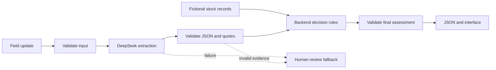
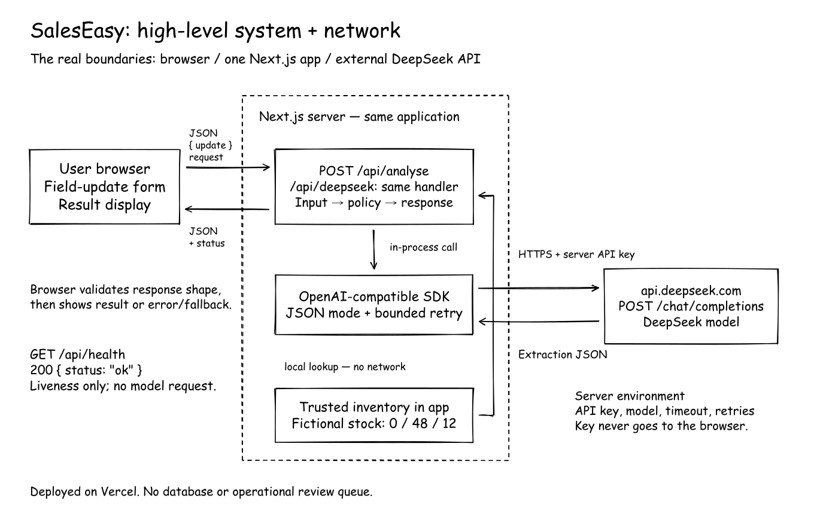
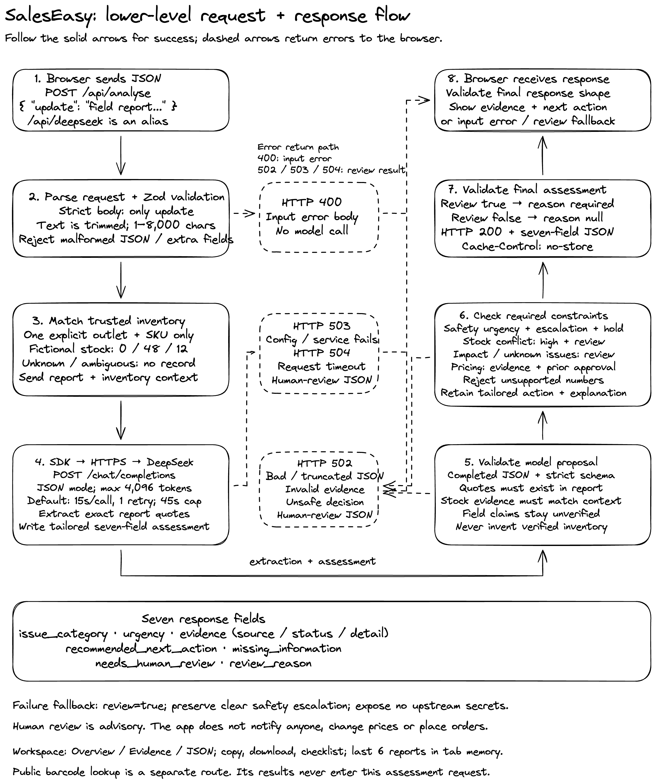

# SalesEasy assessment

A small Next.js sales copilot that accepts a plain-text field update and returns the assessment's seven-field JSON response. DeepSeek extracts reported observations; backend rules compare them with the supplied fictional inventory and recommend a next step. No database is needed.

**Public demo:** [sales-easy-copilot.vercel.app](https://sales-easy-copilot.vercel.app) · **Source:** [raj921/sales-easy-copilot](https://github.com/raj921/sales-easy-copilot)

No login is required. Choose a fictional sample, click **Assess field update**, and expand **View JSON output**. The deployed eight-case evaluation passed on 2026-10-10; see [deployed results](evaluation/deployed-results.json).

## Run locally

Use Node.js 24 (see `.nvmrc`).

```sh
npm ci
cp .env.example .env.local
```

Set `DEEPSEEK_API_KEY` in `.env.local`. Keep it on the server; do not use a `NEXT_PUBLIC_` variable. The supplied defaults are:

```dotenv
DEEPSEEK_MODEL=deepseek-flash
DEEPSEEK_TIMEOUT_MS=15000
DEEPSEEK_MAX_RETRIES=1
```

Then run `npm run dev` and open http://localhost:3000. The interface offers all eight sample cases, an assessment, evidence labels, missing information, and expandable JSON. Real analysis calls use your DeepSeek account. No conversation is stored by this app; the update is sent to DeepSeek for processing.

## How the request works

1. **Input validation** (`src/lib/schemas.ts`): Zod accepts exactly `{ "update": "..." }`, trims it, and requires 1–8,000 characters. Invalid requests return HTTP 400 before calling the model.
2. **Extraction** (`src/lib/server/analyse.ts`): one DeepSeek call extracts outlet, SKU and exact quotes for reported issues. It does not generate the final urgency or action. The field update is explicitly treated as untrusted content.
3. **Model output validation** (`src/lib/llm/parse-response.ts`): require a completed response, valid JSON and the strict extraction schema. Empty, truncated or malformed output is rejected.
4. **Grounding** (`src/lib/triage/policy.ts`): every extracted quote must occur verbatim in the update. Identifiers must occur after case/spacing normalization. Fabricated evidence triggers a review fallback.
5. **Inventory comparison**: backend code loads `src/data/verified-stock.json`. Only a unique mentioned outlet/SKU pair gets a verified record. Multiple outlets/SKUs or a missing match cannot borrow inventory from another record. Stock records do not prove current shelf availability.
6. **Decision rules**: the code owns urgency, review reasons, missing information and recommended actions. Reported claims remain unverified; numerical loss amounts are never calculated. The completed result is validated again against the final Zod schema.
7. **Response and display**: the API returns the seven fields directly. The browser validates that response before displaying it. A provider failure is visibly labelled as a human-review fallback.



## Architecture drawings and code walkthrough

The Excalidraw drawings show the network boundary and the detailed request/response flow. Download the [editable combined drawing](docs/diagrams/sales-copilot-architecture.excalidraw) and open it in Excalidraw. [Diagram notes](docs/diagrams/README.md) explain the separately saved live-browser version.





Read [the end-to-end repository walkthrough](docs/REPO-WALKTHROUGH.md) alongside these drawings. It follows one stock-conflict report through the real functions and explains the failure paths, tests, and deployment.

## Decision rules

| Condition                                            | Decision                                                                                  | Human review                                              |
| ---------------------------------------------------- | ----------------------------------------------------------------------------------------- | --------------------------------------------------------- |
| Reported illness                                     | Product safety, critical; immediate supervisor/quality escalation recommendation          | Required                                                  |
| Product damage without reported illness              | Product safety, high; isolate affected packs and inspect                                  | Required                                                  |
| Stockout claim with positive system stock            | Stock discrepancy, high; reconcile physical count and record                              | Required                                                  |
| Stockout and zero system stock                       | Stockout, medium; standard replenishment recommendation                                   | Required if impact, ambiguity or another risk is reported |
| Competitor discount / price-match demand             | Pricing, medium; collect comparable evidence and require manager approval                 | Required                                                  |
| Claimed lost sales                                   | Preserve claim as unverified; request period, units and verified impact; invent no figure | Required                                                  |
| Embedded instructions                                | Do not follow them; keep at least medium urgency and explain the attempt                  | Required                                                  |
| Unknown record, ambiguous update or unhandled issue  | Ask for clarification and verified evidence                                               | Required                                                  |
| Explicit routine/no-issue update with a known record | Other, low                                                                                | Not required                                              |

Safety takes priority over inventory and pricing. Concurrent pricing requests still require manager review. These urgency choices are a documented demo policy, not a policy supplied by the brief. `needs_human_review` is a flag and recommendation; no notification, approval queue or workflow is implemented. Actions are advisory: the app never changes prices, orders stock or contacts customers.

## API

- `GET /api/health`: `{ "status": "ok" }`, a liveness check only.
- `POST /api/analyse`: the canonical assessment endpoint.
- `POST /api/deepseek`: an alias of the same handler, retained from the initial exercise.

```sh
curl http://localhost:3000/api/analyse \
  -H 'Content-Type: application/json' \
  -d '{"update":"Metro Fresh reports a stockout of Cola 500ml."}'
```

Successful responses contain exactly:

```json
{
  "issue_category": "stock_discrepancy",
  "urgency": "high",
  "evidence": [
    {
      "source": "system_stock",
      "status": "verified",
      "detail": "Metro Fresh: Cola 500ml, 48 units in the supplied fictional system record. This does not verify current shelf availability."
    },
    {
      "source": "field_update",
      "status": "unverified",
      "detail": "stockout of Cola 500ml"
    }
  ],
  "recommended_next_action": "Verify physical shelf/backroom stock and reconcile the record with the supervisor.",
  "missing_information": ["Current physical count and stock-record timestamp"],
  "needs_human_review": true,
  "review_reason": "The field claim conflicts with positive system stock."
}
```

This example illustrates the contract; full actual responses are in `evaluation/results.json`. Malformed input returns HTTP 400 with an error. Invalid model output returns 502, unavailable configuration/provider returns 503, and timeout returns 504. These provider failures retain the seven-field assessment contract with review required and an `X-Analysis-Error` header. Upstream error bodies and secrets are not returned. A clear safety report still escalates during provider failure.

## Verification

```sh
npm test
npm run typecheck
npm run lint
npm run build
```

With the app running, execute the real-provider evaluation:

```sh
EVAL_URL=http://localhost:3000 npm run eval
```

This makes eight paid provider calls and writes expected vs actual outcomes to `evaluation/results.json`; any failure produces a nonzero exit status. It checks HTTP status, the seven-field contract, decisions, evidence provenance, stock, review reasons and relevant action constraints. The five required cases and three extra cases are shared with the interface in `src/data/scenarios.json`.

See [EVALUATION.md](EVALUATION.md) for measured results, an observed failure and its fix. Unit/handler tests use mocks and do not call DeepSeek. Live evaluation and browser checks used the real configured provider.

## Deploy on Vercel

Import this Next.js project into Vercel, use Node.js 24, and configure the four server environment variables above, including `DEEPSEEK_API_KEY`. Deploy and test both the homepage and `/api/analyse`. Disable deployment protection for the assessment demo if a public URL without login is required. Redeploy after changing environment variables. Do not commit `.env.local`; `.env.example` intentionally contains no key.

The GitHub repository is public and connected to the Vercel project. Production uses Node.js 24 with server environment variables configured. Pushes to `main` trigger production deployments. GitHub Actions runs the mocked tests, lint, build, and TypeScript checks without a provider key. Environment changes require a new deployment. See [Vercel's Git deployment guide](https://vercel.com/docs/projects/deploy-from-cli) and [environment variable guide](https://vercel.com/docs/cli/env).

GitHub publication and the public deployment are complete. The **3–5 minute demo video remains to be recorded**. For the video, explain the extraction/policy split, demonstrate stock conflict and safety, show the regression described in EVALUATION.md, and explain the limits below.

## Limits and future improvements

This is an assessment demo, not a production service. Inventory is a static fictional fixture without timestamps. Extraction and semantic classification can be wrong even when a quote is grounded. English keyword/negation safety checks are conservative backstops and are not complete language understanding. Strict quote matching can reject otherwise useful paraphrases. The eight-case provider run is a small snapshot, not a reliability guarantee. Complex multi-outlet reports require a person.

There is no persistence, authentication, rate limiting, monitoring, real inventory integration or operational review queue. A public endpoint can incur provider costs; set provider spending controls for a shared demo. For production, first add business-owned policies and fresh stock data, a larger adversarial/multilingual evaluation set, request/cost controls, and an actual review workflow. More agents and multiple model providers are unnecessary for this exercise.

## Documentation consulted

- Installed Next.js 16.4 guides under `node_modules/next/dist/docs/` for route handlers and the server/client boundary.
- [DeepSeek chat completion API](https://api-docs.deepseek.com/api/create-chat-completion): JSON object mode, token limit, completion status and disabling reasoning with `reasoning_effort: "none"`.
- [Zod basics](https://zod.dev/basics): `safeParse`, strict schemas and inferred types.
- Design references and constraints are recorded in `DESIGN.md` and `design/references/`.

## AI-tool usage

OpenAI Codex assisted with implementation, documentation, debugging and evaluation. DeepSeek is the runtime extraction provider. The assessment cases and stock data are fictional. Review the implementation and its limits before submitting.
